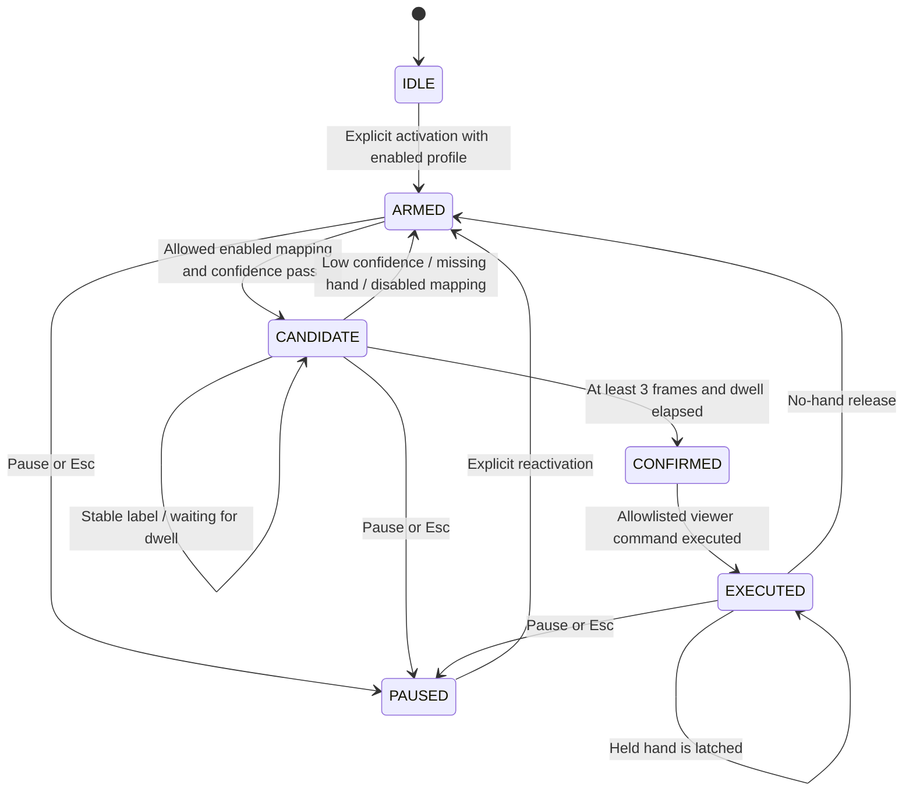

# Architecture

## Data flow

```mermaid
flowchart LR
  A[Browser webcam JPEG / seeded synthetic landmarks] --> B[Local MediaPipe + OpenCV / synthetic generator]
  B --> C[21 x 3 finite landmarks]
  C --> D[Exponential smoothing]
  D --> E[Wrist subtraction and palm-scale normalization]
  E --> F[Personalized distance-weighted KNN]
  F --> G[Confidence and enabled source-matched mapping]
  G --> H[SafeIntent: dwell, stability, latch, cooldown]
  H --> I[Command enum allowlist]
  I --> J[Reversible synthetic viewer state]
  J --> K[Visible confirmation and event history]
```

React owns presentation, camera permission/capture, the input loop, and phantom rendering. FastAPI owns model fitting, recognition, settings, mappings, authoritative safety state, viewer transitions, logs, and evaluation. Sequential capture avoids piling up video frames. Request serialization prevents races across state-changing endpoints. One backend worker and one browser user are supported.

## Safety state machine

`CONFIRMED` is an internal transition before execution, recorded with the transition chain in accepted event logs. New labels restart candidate timing. Input gaps over 750 ms discard dwell progress. Cooldown is evaluated using server monotonic time. Resume clears the candidate; a held gesture after an explicit resume must satisfy dwell again. Pause cancels pending validation when received by the local server. The frontend stops its input loop immediately and ignores late responses.

Safety state and viewer state are intentionally transient. Restarting the server returns to IDLE. Settings, samples, mappings, events, and benchmarks persist in SQLite. The classifier never invokes the viewer; only the controller applies returned allowlisted actions. Manual controls are an explicitly labeled fallback, independently validated by the same command enum, and remain available while gesture execution is paused.

## ML design

- `features.py`: validate shape `(21,3)` and finite values, subtract wrist, divide by wrist-to-middle-MCP distance. Zero-scale samples are rejected.
- `classifier.py`: 3-neighbor distance-weighted KNN, reduced neighbor count for small training sets. Confidence is `max_vote_probability * exp(-0.5 * (nearest_distance / (0.35 * sensitivity))**2)`. Distance rejection also applies when only one class exists.
- `safety.py`: prediction sequence validation is independent of static classification. This is temporal validation of static poses, not a dynamic-gesture recognizer.
- Every fourth enrollment sample is held out; held-out landmarks never enter model fitting. Re-enrollment replaces that profile's training and evaluation samples and retrains all current profiles.
- Input source mismatch disables execution: synthetic training cannot authorize a live camera prediction. Rotation and handedness normalization are future work.

## Evaluation methodology

Each reserved sample is classified by the personalized model and compared with its assigned command. Unknown/low-confidence predictions count as errors. The fixed baseline uses the nearest of five fixed synthetic poses mapped to zoom in, zoom out, next slice, previous slice, and reset. Both models' command predictions are evaluated against the same expected commands; macro averages include command classes present in the test labels. Gesture-label metrics are also included in JSON.

For safety replay, the prediction is held over deterministic 100 ms steps, interspersed with release/cooldown intervals, plus a two-second no-hand interval. An isolated SafeIntent instance receives these frames. The real viewer is never changed by a benchmark. Accepted actions are compared with explicitly labeled expected actions to calculate false activations per replay minute. This test does not establish real-user idle-motion safety.

Metrics can be poor or unavailable. A single gesture with three test examples is especially limited. Replaying the same split is repeatable, but does not create independent new evidence. There is no fabricated data or fixed success score.

## Privacy and security boundaries

Loopback server, same-origin proxy, strict request schemas, bounded camera request size, no arbitrary uploads, no raw frame persistence, no external LLM, no medical-system access. Assistant proposals are disabled until confirmed and enabled manually. Its parser accepts one supported command and rejects ambiguous or dangerous phrases. Configuration cannot contain executable code.

The database is not encrypted. Filesystem permissions and any cloud backup/sync of the workspace are outside the app's control. Use a nonsynchronized path for actual private profiles. MediaPipe is pinned to 0.10.21 after a newer installed release attempted diagnostic telemetry during testing. The app itself has no telemetry/network-upload code. Offline operation and third-party dependency network behavior have not been comprehensively audited.
